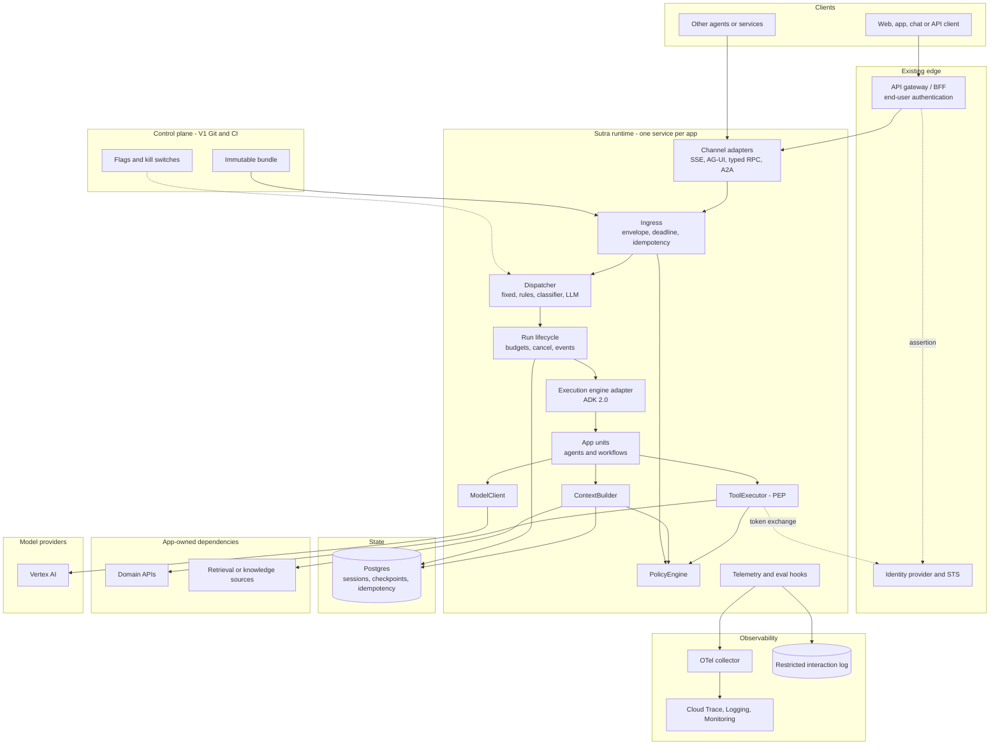
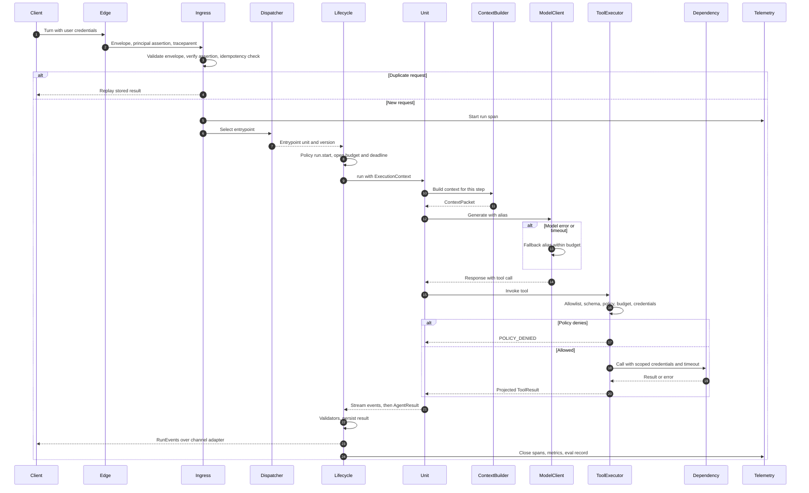
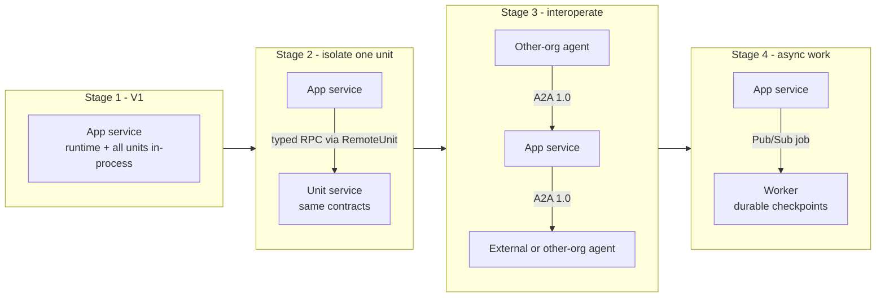

# Harness Architecture

## 1. Layers

| Layer | Owns | Owned by |
|---|---|---|
| **Channel adapters** | Translate transport to and from harness contracts: SSE / AG-UI for UIs, typed RPC for Sutra-to-Sutra calls, A2A for external agents | Platform |
| **Runtime shell** | Ingress, dispatcher, run lifecycle, deadlines, cancellation, budgets, event stream, config loading | Platform |
| **Engine adapter** | Runs units on ADK 2.0. Maps ADK events to `RunEvent`. Registers harness plugins. | Platform |
| **Harness library** | `ContextBuilder`, `ModelClient`, `ToolExecutor`, `PolicyEngine`, `Telemetry`, eval hooks, testing kit | Platform |
| **App units** | Agents and workflows, prompts, tool definitions, policies, evals | App team |
| **Dependencies** | Domain APIs, knowledge sources, model providers, Postgres, observability backends | Existing or managed |

The harness has **no knowledge of any domain**:

- no intent taxonomy;
- no domain objects;
- no UI components.

Applications provide those through manifests and code.

## 2. Component view

## 3. Components

| Component | Responsibility | Key rule |
|---|---|---|
| **Ingress** | Validates the envelope, verifies the principal assertion, enforces deadline caps and request idempotency, starts the run span | Rejects anything it cannot verify. Clients never supply identity in the body. |
| **Channel adapters** | Map `RunEvent` to SSE, AG-UI, typed RPC or A2A | Units never emit protocol-specific events |
| **Dispatcher** | Selects the entrypoint unit. Strategies: `fixed` (single unit), `rules`, `classifier`, `llm`, `tiered`. | Optional. A single-unit app uses `fixed` and pays no routing cost. |
| **Run lifecycle** | `accept → dispatch → execute → validate → finalize`. Owns budgets, deadlines, cancellation, the event sequence and the result store. | Exactly one terminal event per run |
| **Engine adapter** | Wraps ADK 2.0 agents and workflows as the harness `Unit`. Registers plugins: safety, policy guard, budget, telemetry. | The only package that imports ADK |
| **ContextBuilder** | Assembles per-step context from declared providers, with authorization recheck, trust labelling, budgets and stable-prefix ordering | A unit receives only what its `ContextSpec` declares |
| **ModelClient** | Model aliases, capability checks, fallback, timeouts, token and cost accounting, structured output | No raw model IDs in app code |
| **ToolExecutor** | Allowlist, argument validation, bound arguments, policy, credentials, timeout, retry, circuit breaker, idempotency, confirmation, audit | The only path to tool credentials |
| **PolicyEngine** | Synchronous, in-process decisions: allow, deny, require confirmation, require step-up, plus obligations | No I/O on the request path |
| **Telemetry** | OTel spans, metrics and logs following the GenAI semantic conventions. `SafeAttributes` allowlist. | No content in spans |
| **Eval hooks** | Synchronous validators before emission. Asynchronous sampled eval records after emission. | Never blocks the user on async evaluation |

## 4. Extension points (what an app plugs in)

| Extension | Interface | Typical example |
|---|---|---|
| Unit | Manifest + `build(BuildContext)` factory | An LLM agent with two tools; a graph workflow |
| Tool | `ToolDefinition` + typed client | Read-only lookup against an internal API |
| Context provider | `ContextProvider` | Knowledge-base search; user preferences |
| Dispatcher strategy | `DispatchStrategy` | Rules file; trained classifier |
| Validator | `Validator` | "The answer cites at least one retrieved source" |
| Policy rules | YAML in the bundle | "Tool X requires auth level `authenticated`" |
| UI payload types | Versioned `UiBlock` schemas | Cards, lists, forms |
| Channel adapter | `ChannelAdapter` | Slack or Teams bot, voice |

## 5. Generic run sequence

## 6. Deployment (V1)

- One Cloud Run service per application. It contains the runtime shell, the harness library and all of that app's units.
- An OTel collector sidecar [A: confirm the current Cloud Run multi-container limits].
- Postgres (Cloud SQL) for sessions, checkpoints and idempotency.
- Vertex AI for models.
- The existing API gateway and identity provider at the edge.
- Secrets in Secret Manager, accessed with workload identity.

A "logical agent" is **not** a deployment unit. Many units share one process.

## 7. Evolution without rewrites

Where a unit runs is a **config decision**. The caller always holds a `Unit` interface: in-process, `RemoteUnit` (typed RPC), or `A2AUnit`.
