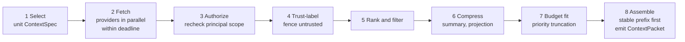

# Context and State

Context is assembled **per model call** by `ContextBuilder` from declared providers. It is never "everything in the session".

## 1. Context kinds

| Kind | Typical source | Trust | Lifetime | Cacheable | Default share of budget |
|---|---|---|---|---|---|
| Instructions | Versioned prompt files in the bundle | Trusted | Release | Yes (provider prefix cache) | 10–20% |
| Policy | Model-facing rules from the policy bundle | Trusted | Release | Yes (prefix) | Small |
| App config | Locale, feature flags, app constants | Trusted | Release | Yes (prefix) | Small |
| Conversation | Session events (Postgres) | User text untrusted | Session | No | 15–30% |
| Task state | Typed unit or workflow state | Trusted (computed) | Run | No | Small |
| Tool results | `ToolExecutor` (projected) | Free-text fields untrusted | Run | Only public data | 20–40% |
| Retrieved | App's knowledge or search providers | Untrusted | Request | Yes (retrieval cache) | 20–40% |
| Preferences | App's profile or preferences provider | Semi-trusted | Long | Per-user, in-process, short TTL | 0–5% |

## 2. Pipeline



1. **Select.** Only the providers and kinds declared in the unit's `ContextSpec`.
2. **Fetch.** Concurrent, under a deadline slice. A missing optional provider is omitted and recorded. A missing required provider raises `DEPENDENCY_UNAVAILABLE`.
3. **Authorize.** Drop items whose `principal_scope` does not match the current principal. This applies to cache hits as well.
4. **Trust-label.** Untrusted text goes into delimited data blocks and is never merged into instructions.
5. **Rank and filter.** Relevance and recency. History is the last K turns plus the rolling summary.
6. **Compress.**
   - Field projection for tool results.
   - Snippet extraction for documents.
   - A rolling conversation summary, generated asynchronously after the turn. ADK compaction may be used where ADK manages history [V].
7. **Budget fit.** Per-kind token caps. Lowest priority is truncated first, and the truncation is recorded.
8. **Assemble.**
   - Stable prefix first: instructions → policy → app config → tool schemas.
   - Then the summary, then dynamic items.
   - Emit a `ContextPacket` manifest: IDs, versions, token counts, no content.

## 3. State stores

| State | V1 store | Notes |
|---|---|---|
| Conversation events | Postgres (Cloud SQL) via the ADK session service, events as JSONB | JSONB because the ADK 2.0 event schema evolves [V] |
| Checkpoints (resume) | Same Postgres | Only for units with `resumable: true` |
| Request idempotency (stored results) | Postgres | TTL 24 h [R] |
| Tool idempotency records | Postgres | `pending → done` with result hash; TTL 30 days for writes [R] |
| Conversation summary | Postgres | Regenerated asynchronously |
| Preferences, profiles | **App-owned service** via `ContextProvider` | The harness stores none |
| Knowledge, vectors | **App-owned retrieval** via `ContextProvider` | The harness provides no vector DB |
| Audit | Locked-retention bucket | Writes, denials, step-ups |

## 4. Caching and storage are different things

| Mechanism | Stores | Where | Personal data allowed? | V1 |
|---|---|---|---|---|
| Prefix (context) caching | The provider's processed form of a stable prompt prefix | Model provider [V: ADK context caching] | No (the prefix contains none by construction) | Yes |
| Retrieval caching | Results from public or app-scoped providers | In-process LRU | No | Yes |
| Response caching | Final outputs | Our cache | **No** for personalized output; only public, deterministic, versioned outputs | Optional, off by default |
| Conversation storage | Authoritative event log | Postgres | Yes (governed) | Yes |
| Semantic memory | Learned facts across sessions | n/a | Requires consent design | No |

### Cache key

```text
key = H(scope, tenant, app, user_hmac?, purpose, normalized_input,
        versions{prompt, model, index, policy, source_snapshot}, locale)
```

### Isolation rules

- `scope` is a required type parameter. It is impossible to write to the cache without one.
- User-scoped entries stay in-process with a TTL of 5 minutes or less. They are never sent to a shared cache in V1.
- Every read rechecks authorization against provenance.
- Never cache:
  - data fetched with a delegated user token;
  - safety decisions;
  - anything whose freshness class is "live".
- Invalidation is by version bump. TTL is only a backstop.

## 5. When to add Redis (Memorystore) or a vector store

| Add | Only if |
|---|---|
| Shared cache | The measured cross-instance duplicate rate projects a hit rate above 50% with meaningful savings, **or** latency budgets are missed and caching fixes it |
| Session cache | Postgres p99 above 20 ms or connection limits at peak, after pooling and tuning |
| Vector store in the harness | Never as a harness default. Apps bring retrieval. Revisit if 3 or more apps need the same managed retrieval capability. |

## 6. Metrics

| Metric | Labels |
|---|---|
| `sutra.context.tokens` | app, unit, kind |
| `sutra.context.truncations` | app, unit, kind |
| `sutra.context.provider.duration` | provider, outcome |
| `sutra.cache.requests` | purpose, result (hit, miss, stale, denied) |
| Cached-input-token ratio | model alias, unit |
| Cost per successful run | app, unit |
