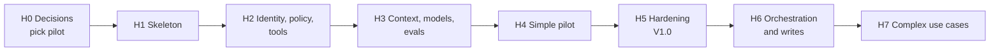

# Minimum Viable Harness, NFRs and Roadmap

## 1. Minimum viable harness (V1)

| # | Capability | V1 scope |
|---|---|---|
| 1 | Contracts package | Request, result, events, unit and tool definitions, context, model, policy, dispatch, telemetry and eval contracts. JSON Schema export. |
| 2 | Runtime shell | Ingress, deadlines, cancellation, request idempotency, conversation lock, lifecycle, SSE adapter |
| 3 | Engine adapter | `AdkUnit` (ADK 2.0), `FunctionUnit`, event mapping, the four plugins (safety, policy guard, budget, telemetry), resumability when declared |
| 4 | Dispatcher | `fixed` and `sticky` in V1.0. `rules`, `classifier`, `llm` and `clarify` in V1.x (see roadmap). |
| 5 | Identity | Principal assertion verification, auth levels, conversation ownership, token exchange client |
| 6 | `ToolExecutor` | Allowlist, validation, bound args, policy, credentials, timeout, one retry layer, breaker, idempotency, audit. Confirmation tokens in V1.x. |
| 7 | `ModelClient` | Aliases, capabilities, fallback, timeouts, token and cost accounting, structured output |
| 8 | `ContextBuilder` | Providers, authorization recheck, trust labels, budgets, stable-prefix ordering, rolling summary |
| 9 | `PolicyEngine` | In-process YAML rules, CI tests, fail-closed loading |
| 10 | Telemetry | GenAI spans and metrics, `SafeAttributes`, collector redaction, interaction log, audit sink |
| 11 | Evaluation | Testing kit (fakes, scenario runner, contract test kit), CI eval gates, regression pipeline |
| 12 | Delivery | Cloud Run template, Terraform module, shared CI template, app template (cookiecutter) |
| 13 | Docs | Golden path: add a tool, add a unit, add an eval, deploy |

**Explicitly excluded from V1:**

- Marketplace or catalog UI.
- Visual builder.
- Autonomous multi-agent planning.
- Cross-cloud or multi-framework portability.
- A control-plane service.
- Model or agent gateway services.
- Redis or Memorystore.
- A harness-owned vector DB.
- Semantic memory.
- Self-hosted inference.
- Tail sampling.
- AI-observability SaaS.
- Async jobs.

## 2. Harness NFRs (provisional [R])

These measure the **harness itself**. App-level latency and quality targets are set per use case.

| NFR | Target | Notes |
|---|---|---|
| Harness overhead per run (excluding model and tool time) | p50 ≤ 20 ms, p95 ≤ 50 ms | Ingress, dispatch (`fixed`), lifecycle, context assembly, telemetry |
| Overhead per tool call (excluding the call) | p95 ≤ 5 ms (token exchange cached) | Policy + validation + accounting |
| Time to first event | p95 ≤ 300 ms after ingress | `run.started` / `progress` |
| Runtime availability (excluding dependencies) | 99.9% | Cloud Run + Cloud SQL high availability |
| Cross-user data exposure | 0 | Hard requirement; isolation tests in CI |
| Telemetry completeness | 100% of runs in the interaction log; traces per sampling policy | n/a |
| Budget enforcement | No run exceeds the configured cost or tool limits by more than one call | n/a |
| Cold-start impact | p95 first-request latency ≤ 2 s with min instances ≥ 1 | [A: measure] |
| Onboarding a read-only tool | ≤ 2 days | Measured in pilot |
| Onboarding a new unit (with evals) | ≤ 1 week for a single agent | Measured in pilot |
| New app from template to staging | ≤ 1 day | Measured in pilot |
| Rollback | ≤ 5 min | Traffic shift to the previous revision |

**Inputs still needed:**

- the expected number of apps and their traffic;
- data retention policies;
- IdP and STS capabilities;
- the organization's flag system;
- the approved model list.

## 3. Repository layout

The repository is one Python distribution, `sutra`. Import rules are enforced in CI:

- `contracts` imports nothing internal.
- Only `engine_adk` imports ADK.
- Apps import only `sutra.contracts`, `sutra.sdk` and `sutra.testing`.

```text
sutra/
├── pyproject.toml
├── src/sutra/
│   ├── contracts/        # Pydantic models + Protocols, JSON Schema export
│   ├── runtime/          # ingress, lifecycle, deadlines, cancel, idempotency, events, adapters/
│   ├── dispatch/         # fixed, sticky, rules, classifier, llm, clarify strategies
│   ├── engine_adk/       # AdkUnit, event mapping, plugins, model adapter, tool wrappers
│   ├── context/          # ContextBuilder, built-in providers (conversation, summary), cache
│   ├── models/           # ModelClient, alias registry, fallback, accounting, providers/
│   ├── tools/            # ToolExecutor, registry, credentials, breakers, idempotency, confirm
│   ├── identity/         # assertion verification, auth levels, token exchange
│   ├── policy/           # PolicyEngine, rule compiler, bundle verification
│   ├── telemetry/        # OTel setup, semconv pin, SafeAttributes, interaction + audit sinks
│   ├── state/            # Postgres repositories, migrations
│   ├── eval/             # runners, deterministic checks, judge harness, regression importer
│   ├── sdk/              # small public surface for app authors (decorators, helpers)
│   └── testing/          # FakeModelClient, RecordedTool, scenario runner, contract test kit
├── templates/app/        # cookiecutter: new app with one unit, one tool, one eval
├── deployment/
│   ├── cloudrun/         # service + sidecar template
│   ├── terraform/        # module: Cloud SQL, SAs, secrets, BigQuery, audit bucket
│   └── otel-collector/   # config with redaction processor
├── examples/
│   └── echo_app/         # reference app used by harness CI (no real dependencies)
├── tests/                # unit, contract, integration, isolation, load
└── docs/
    ├── design/           # this design
    └── use-cases/        # per-use-case designs
```

Apps live in their own repositories and depend on `sutra>=x.y`. During the pilot, the first app may live under `apps/` in this repository for speed.

## 4. Roadmap

### H0: Decisions and inputs

| Item | Detail |
|---|---|
| Scope | <ul><li>Confirm the ADK version and language.</li><li>Confirm IdP and STS capabilities.</li><li>Confirm the flag system, approved models and retention policies.</li><li>**Select the pilot use case** (§5).</li></ul> |
| Deliverables | Signed-off ADRs; pilot use case chosen with an owning team; NFR inputs |
| Acceptance | Every [A] in these docs is resolved or has an owner |
| Out of scope | Code |

### H1: Contracts and walking skeleton

| Item | Detail |
|---|---|
| Scope | <ul><li>`contracts`, runtime shell, `fixed` dispatch.</li><li>`AdkUnit` spike: event mapping, plugins, resume in Postgres, cancel.</li><li>`FunctionUnit`, SSE adapter, telemetry baseline.</li><li>`echo_app`, Cloud Run deploy, CI with import rules.</li></ul> |
| Deliverables | `sutra` v0.1; ADK 2.0 spike findings; end-to-end trace with GenAI attributes |
| Tests | Contract kit (deadline, cancel, single terminal event); event mapping; resume with deduplication |
| Acceptance | `echo_app` runs in staging; no ADK import outside `engine_adk`; trace and interaction-log row present |
| Risks | ADK gaps. Mitigation: a time-boxed spike, with results feeding ADR-001 triggers. |
| Out of scope | Real data, identity, tools |

### H2: Identity, policy and tools

| Item | Detail |
|---|---|
| Scope | Assertion verification, auth levels, ownership checks, token exchange, `PolicyEngine`, `ToolExecutor` (read tools), audit sink |
| Deliverables | `sutra` v0.2; security test suite |
| Tests | Forged or expired assertions, cross-user access, allowlist bypass, fault injection (breaker and retry), redaction |
| Acceptance | Zero cross-user access in the suite; every tool call spans and audits correctly; security review sign-off |
| Risks | STS not ready. Mitigation: the interim signed context, as a tracked exception. |
| Out of scope | Write tools, MCP |

### H3: Context, models and evaluation

| Item | Detail |
|---|---|
| Scope | `ContextBuilder` and built-in providers, `ModelClient` (aliases, fallback, accounting), testing kit, CI eval gates, interaction-log pipeline, app template |
| Deliverables | `sutra` v0.3; golden-path docs draft |
| Tests | Cache isolation, budget truncation, injection via retrieved text, fallback on provider error |
| Acceptance | Template app with one unit and one tool goes from zero to staging in ≤ 1 day |
| Out of scope | Dispatcher strategies beyond `fixed` and `sticky` |

### H4: Pilot use case (simple)

| Item | Detail |
|---|---|
| Scope | Build the selected simple use case on the harness. One unit, at most 3 read-only tools or one knowledge provider. Shadow, then canary. |
| Deliverables | Pilot in production (or internal GA); dashboards; runbook; measured onboarding times |
| Tests | App evals (deterministic first); load at the expected peak; chaos (provider down, tool down) |
| Acceptance | Harness NFRs met; app quality targets met; no harness changes that are pilot-specific |
| Risks | The pilot pulls domain logic into the harness. Mitigation: code review rule — no domain types in `src/sutra`. |
| Out of scope | Writes, multi-unit dispatch |

### H5: Hardening and V1.0

| Item | Detail |
|---|---|
| Scope | Load and soak, breaker tuning, SLOs and alerts, sampling ramp-down, DR test, documentation, and the feedback on harness friction from the pilot |
| Deliverables | `sutra` v1.0, published package, CI template |
| Acceptance | NFRs held for 2 weeks; rollback rehearsed ≤ 5 min |

### H6: Orchestration and writes (V1.x)

| Item | Detail |
|---|---|
| Scope | Dispatcher chain (rules, classifier, LLM, clarify), bounded delegation, confirmation tokens for writes, `RemoteUnit`, optional AG-UI adapter |
| Deliverables | Features behind per-app opt-in, with eval support for dispatch |
| Acceptance | A second, multi-unit app onboards with no harness forks |
| Out of scope | Autonomous planning, A2A server (unless an interop need appears) |

### H7: Complex use cases

Customer-facing, multi-unit, identity-sensitive applications (for example a shopping or order-support assistant) start here, on a proven harness.



## 5. Choosing the pilot use case

| Criterion | Prefer |
|---|---|
| Risk | Read-only; no payments; no regulated data |
| Users | Internal employees, or a small opt-in audience |
| Shape | One unit; 1–3 tools or one knowledge source |
| Correctness | Verifiable against a source (deterministic eval checks possible) |
| Dependencies | Existing APIs or content with clear owners and auth |
| Team | An owning team willing to give feedback on harness friction |
| Value | Visible enough to justify the effort; not on a critical revenue path |
| Coverage | Exercises identity, one tool, context, telemetry and evals end to end |

**Candidate shapes** (to choose in H0):

- An internal docs or runbook Q&A assistant over an existing search index.
- An employee policy help desk (HR or IT) with citations.
- A read-only status lookup over one internal API (for example ticket or job status) for authenticated employees.
